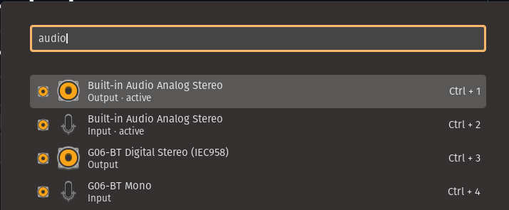
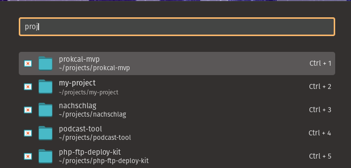

# popos-launcher-plugins

Small [pop-launcher](https://github.com/pop-os/launcher) plugins for Pop!_OS (Super key launcher).

| Plugin | Trigger | What it does |
|---|---|---|
| [audio-switch](audio-switch/) | `audio`, `out`, `mic` | Switch audio output and microphone |
| [proj](proj/) | `proj` | Open a folder from `~/projects` in PhpStorm |

## Screenshots

**`audio`** lists outputs and microphones together, the active device is marked:



**`proj`** shows the most recently used projects, typing a filter searches all folders:



## Install

```sh
./install.sh                # all plugins
./install.sh proj           # just one
./install.sh --list         # show available plugins
./install.sh --uninstall    # remove again (all, or the named ones)
```

Symlinks each plugin folder to `~/.local/share/pop-launcher/plugins/`. No sudo needed.
The installer warns about missing dependencies (`pactl`, PhpStorm) and restarts the launcher.
